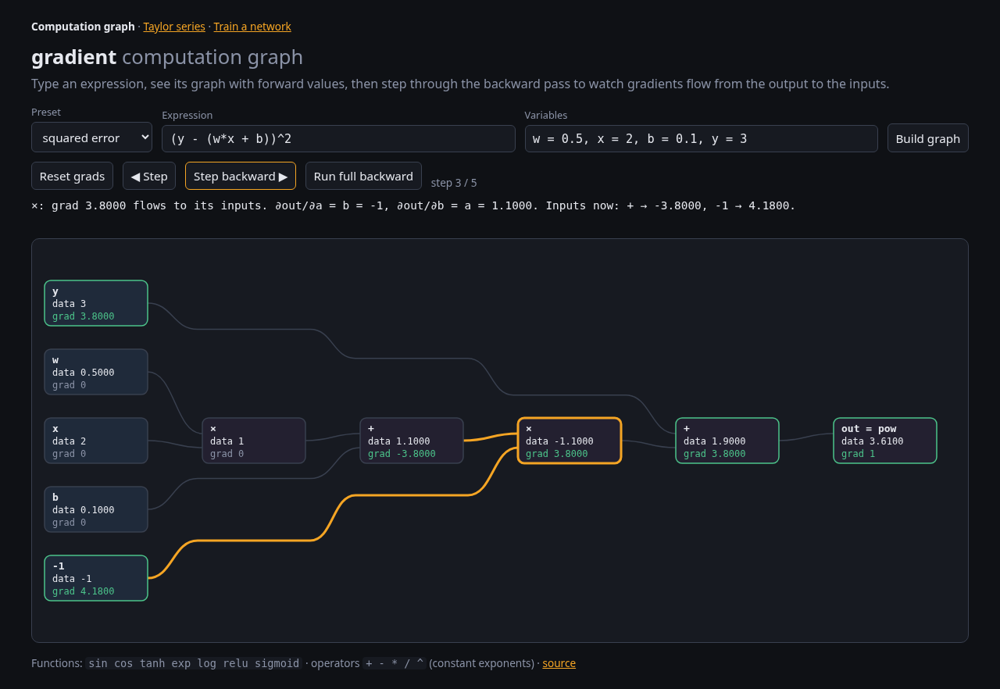
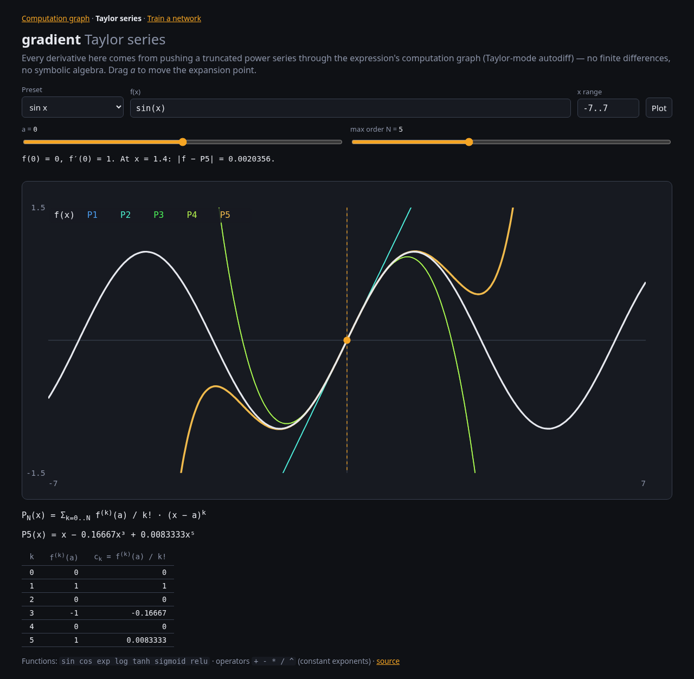
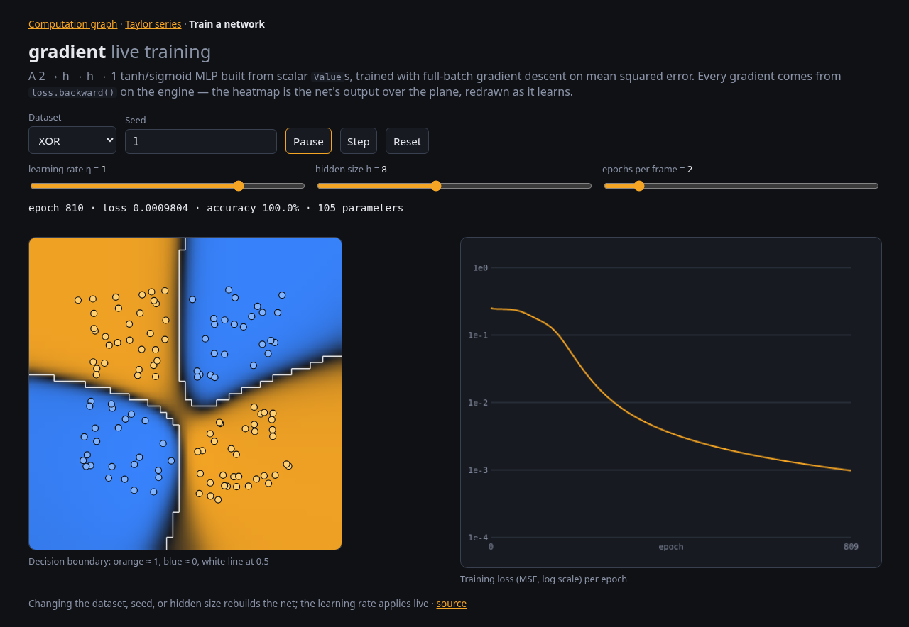

# gradient

[](https://github.com/MechStudents2029/gradient/actions/workflows/ci.yml)
[](https://gradient-two-amber.vercel.app)
[](LICENSE)

A from-scratch reverse-mode automatic differentiation engine in TypeScript,
with three browser demos built on it: a computation-graph debugger that steps
through backprop one node at a time, Taylor series computed by Taylor-mode
autodiff, and a small neural network trained live on 2D toy data.

No dependencies at runtime: every number on screen comes from a scalar
`Value` graph and its `backward()` pass.



## Live demos

| page | what it shows |
| --- | --- |
| [Computation graph](https://gradient-two-amber.vercel.app) | Type any expression, see its graph with forward values, step the backward pass and watch gradients flow to the inputs. |
| [Taylor series](https://gradient-two-amber.vercel.app/taylor.html) | f(x) against its Taylor polynomials P₁..P_N around a draggable point a, every coefficient from Taylor-mode autodiff. |
| [Train a network](https://gradient-two-amber.vercel.app/train.html) | A tanh/sigmoid MLP learning XOR, two moons, or circles with a live decision boundary and loss curve. |

## Features

- **Scalar autodiff core**: `Value` with `+ − × ÷`, constant powers, `exp`,
  `log`, `tanh`, `relu`, `sigmoid`, `sin`, `cos`, and reverse-mode `backward()`.
- **Gradient checks**: every op is tested against central finite differences.
- **Neural nets**: `Neuron`, `Layer`, `MLP`, MSE loss, and SGD, all seeded so
  runs are reproducible.
- **Expression parser**: `parseExpr("tanh(a*b + c)", { a: 2, ... })` builds a graph from text.
- **Graph export and layout**: `toGraph`, a layered `layoutGraph`, and
  `routeEdges`, which steers edges that skip a column around the nodes in
  between instead of drawing over them.
- **Step-by-step backward**: `backwardTrace` snapshots every gradient after
  each local chain-rule step.
- **Taylor-mode autodiff**: exact f⁽ᵏ⁾(a) for any order in one forward sweep.
- **Training helpers**: seeded toy datasets, `Trainer`, accuracy, and a
  decision-boundary grid.

## Quick start

```sh
git clone https://github.com/MechStudents2029/gradient.git
cd gradient
npm install
npm test          # Vitest suite
npm run dev       # demos at http://localhost:5173
npm run build     # static site in dist/
```

```ts
import { Value } from "./src/index.js";

const x = new Value(0.5, [], "", "x");
const w = new Value(-1.2, [], "", "w");
const y = x.mul(w).add(0.3).tanh();
y.backward();
console.log(y.data, x.grad, w.grad); // dy/dx = w(1 - y²), dy/dw = x(1 - y²)
```

Train a 2-4-1 network on XOR:

```ts
import { MLP, mse, sgdStep } from "./src/index.js";

const xs = [[0, 0], [0, 1], [1, 0], [1, 1]];
const ys = [0, 1, 1, 0];
const net = new MLP([2, 4, 1], { hidden: "tanh", output: "sigmoid", seed: 1 });
for (let step = 0; step < 2000; step++) {
  const loss = mse(xs.map((x) => net.forward(x)[0]!), ys);
  loss.backward();
  sgdStep(net.parameters(), 1.0);
}
```

## How reverse-mode autodiff works

Every arithmetic operation creates a `Value` that remembers its inputs
(parents) and how to differentiate itself locally. A whole program therefore
becomes a directed acyclic graph that ends at one output L.

**Chain rule.** If L depends on a parent p only through a child c = f(p, ...),
then

```
∂L/∂p = ∂L/∂c · ∂c/∂p
```

∂c/∂p is the op's local derivative (the table below), known as soon as the
forward pass has run. When p feeds several children (like `x` in `x·x + x`),
each path contributes, so gradients are **accumulated**:

```
∂L/∂p = Σ over children c of p:  ∂L/∂c · ∂c/∂p
```

**Topological order.** That sum needs ∂L/∂c to be final for every child
before it is pushed into p. `backward()` gets this from a topological sort: a
depth-first search lists every node after all of its parents, so walking the
list in reverse visits every child before any of its parents. It seeds
∂L/∂L = 1 and then each node runs its local rule once:

```
for c in reversed(topo(L)):
    for p in parents(c):
        p.grad += c.grad · ∂c/∂p
```

**Why reverse.** One backward sweep costs about as much as the forward pass
and yields ∂L/∂θ for *every* input θ at once. Forward mode would need one
sweep per input, which is why reverse mode (backprop) is what trains networks.

| op | local derivative |
| --- | --- |
| `a + b` | 1, 1 |
| `a · b` | b, a |
| `xᵏ` | k·xᵏ⁻¹ |
| `eˣ` | eˣ |
| `ln x` | 1/x |
| `tanh x` | 1 − tanh² x |
| `relu x` | 1 if x > 0 else 0 |
| `σ(x)` | σ(x)(1 − σ(x)) |
| `sin x` | cos x |
| `cos x` | −sin x |

## Graph visualizer

Live demo: **https://gradient-two-amber.vercel.app**

The graph page draws any expression as a computation graph. Pick a preset
(tanh neuron, sigmoid neuron, a reused variable, squared error, softplus) or
type your own, e.g. `tanh(x1*w1 + x2*w2 + b)` with `x1 = 2, w1 = -3, ...`.
Every node shows its forward value; press **Step backward** (or →) to apply
one node's local chain-rule step at a time and watch gradients flow back to
the inputs. Nodes sit in columns by depth; an edge that skips a column is
routed through the gap between that column's nodes, so it never hides a box.

The same data is available from code:

```ts
import { parseExpr, toGraph, layoutGraph, routeEdges, routePath, backwardTrace } from "./src/index.js";

const out = parseExpr("tanh(a*b + c)", { a: 2, b: -3, c: 6.5 });
const graph = toGraph(out);          // nodes (topo order) + edges
const layout = layoutGraph(graph);   // x/y for each node id
const routes = routeEdges(graph, layout, { nodeWidth: 132, nodeHeight: 58 });
routePath(routes[0]!.points);        // SVG path data for one edge
const steps = backwardTrace(out);    // gradients after each backward step
```

## Taylor series

Live demo: **https://gradient-two-amber.vercel.app/taylor.html**



`backward()` gives first derivatives. For f″, f‴, ... at a point, gradient
pushes a whole truncated power series through the same graph instead
(Taylor-mode autodiff). Substitute x = a + t; then every node is a polynomial
in t up to degree n:

```
u(a + t) = u₀ + u₁t + u₂t² + ... + uₙtⁿ + O(tⁿ⁺¹)      uₖ = u⁽ᵏ⁾(a) / k!
```

The input is `[a, 1, 0, ...]`, constants are `[c, 0, 0, ...]`, and each op
maps coefficient arrays to coefficient arrays exactly. Products are the Cauchy
product `(uv)ₖ = Σⱼ uⱼvₖ₋ⱼ`; functions come from their ODE. For y = eᵘ,
y′ = y·u′ gives

```
k·yₖ = Σⱼ₌₁..ₖ j·uⱼ·yₖ₋ⱼ
```

so the coefficients fill in one at a time. The result is the Taylor polynomial

```
Pₙ(x) = Σₖ₌₀..ₙ f⁽ᵏ⁾(a)/k! · (x − a)ᵏ
```

with no finite differences and no symbolic algebra.

```ts
import { taylorCoefficients, derivativesAt, taylorPolynomial } from "./src/index.js";

taylorCoefficients("sin(x)", 0, 5);  // [0, 1, 0, -1/6, 0, 1/120]
derivativesAt("exp(sin(x))", 0, 3);  // [1, 1, 1, 0]
const c = taylorCoefficients("log(1 + x)", 0, 6);
taylorPolynomial(c, 0, 0.2);         // ≈ log(1.2)
```

## Live training

Live demo: **https://gradient-two-amber.vercel.app/train.html**



Pick a 2D toy dataset (XOR, two moons, or concentric circles) and a seed, then
press **Start**. A 2 → h → h → 1 network (tanh hidden layers, sigmoid output)
trains with full-batch gradient descent on MSE, and two plots redraw every
frame:

- **Decision boundary**: the net's output over [−1.5, 1.5]², blue ≈ 0 and
  orange ≈ 1, with the 0.5 contour drawn in white and the training points on top.
- **Loss curve**: MSE per epoch on a log scale.

The learning-rate slider (η from 0.01 to about 4, log scale) applies live, so you
can push η too high mid-run and watch the loss blow up. Changing the dataset,
seed, or hidden size rebuilds the network from the same seed, so every run is
reproducible. **Step** runs exactly one epoch.

The same pieces are plain library code:

```ts
import { Trainer, makeDataset, decisionGrid } from "./src/index.js";

const data = makeDataset("moons", { n: 120, seed: 1 });
const t = new Trainer(data, { hidden: 8, lr: 1.0, seed: 1 });
t.step(400);                      // 400 full-batch epochs
t.losses.at(-1);                  // final MSE
t.accuracy();                     // fraction classified correctly at 0.5
decisionGrid(t.net, { res: 50 }); // 50×50 outputs for a heatmap
```

## Training a network

A neuron computes `act(w · x + b)`; a layer is a list of neurons; an `MLP`
stacks layers. Nothing new is needed for backprop: the network is just a big
graph of `Value`s, so `loss.backward()` fills in `∂L/∂θ` for every weight.

The loss is mean squared error and the update is plain gradient descent:

```
L = (1/n) Σ (ŷᵢ − yᵢ)²        ∂L/∂ŷᵢ = (2/n)(ŷᵢ − yᵢ)
θ ← θ − η · ∂L/∂θ
```

Weights start uniform in `[−1, 1) / √nin` from a seeded PRNG, so every run is
reproducible.

## Gradient checking

Every op is tested against the central finite difference

```
f'(x) ≈ (f(x + h) − f(x − h)) / 2h      (error O(h²))
```

via `numericGrad` in `src/gradcheck.ts`, including a deep mixed expression of
`tanh`, `exp`, powers, and division.

## Project structure

```
src/
  value.ts      Value: ops, local derivatives, topo sort, backward()
  gradcheck.ts  central finite-difference gradient for tests
  nn.ts         Neuron, Layer, MLP, mse, sgdStep, seeded PRNG
  expr.ts       expression parser (text -> Value graph)
  graph.ts      toGraph, layoutGraph, routeEdges, backwardTrace
  taylor.ts     Taylor-mode autodiff (jets) and Taylor polynomials
  data.ts       seeded 2D toy datasets
  train.ts      Trainer, predict, accuracy, decisionGrid
  index.ts      public API
web/            Vite demo pages (graph, Taylor, training) importing src/ directly
test/           Vitest suites, one per module
docs/           write-ups of the math and design, plus screenshots
.github/        CI: typecheck, tests, and a demo build on every push and PR
```

CI runs `npm run typecheck`, `npm test`, and `npm run build` on Node 22. The
demo is a static Vite build of `web/` deployed to Vercel.

## Roadmap

- [x] Day 1: scalar `Value` with reverse-mode `backward()` and gradient checks
- [x] Day 2: `sigmoid`, a tiny MLP, and SGD that learns XOR
- [x] Day 3: computation-graph visualizer (web UI), with an early deploy on Vercel
- [x] Day 4: Taylor series via Taylor-mode autodiff, with a plot of f and P₁..P_N (the step-by-step backward walkthrough shipped with Day 3)
- [x] Day 5: live training demo in the browser (XOR, two moons, circles) with a decision-boundary heatmap and loss curve

## License

MIT, see [LICENSE](LICENSE).
